# SOLiD-PINN research atlas

A chronological, evidence-linked overview of the project for researchers. Every graph uses archived aggregate numerical results; no raw collaborator MPH files, OCV curves, or unpublished reference traces are redistributed. Data and scripts remain available for reproducibility subject to access to authorized inputs.

## v0.2 — numerical foundations
Analytical radial diffusion, event refinement and PINN scaling established a baseline for verification, not a full P2D experimental validation. See [historical PR #1](https://github.com/theerayutbo/SOLiD-PINN/pull/1). No fabricated figure is supplied for archived tests without numerical plot data.

## v0.3–v0.4 — calibration and cross-study inputs
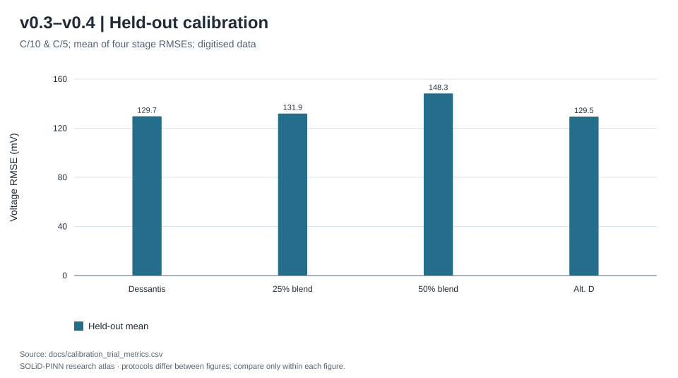
The C20-fitted model did not generalise accurately at higher rates. Mixing external OCV curves increased held-out mean RMSE; substituting D improved it by only 0.2 mV, below digitisation uncertainty. See [calibration ledger](../calibration_experiment_ledger.md). Historical trial protocols are not equivalent to the newer COMSOL transfer.

## v0.5 — constant interface ASR
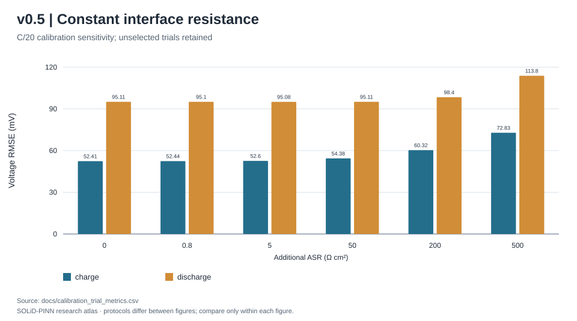
A constant extra ASR did not improve the selected C20 objective; zero was selected on this grid, not proven physically zero. Nonselected trials remain documented in the [ledger](../calibration_experiment_ledger.md).

## v0.6–v0.6.1 — independent solvers and analytical verification
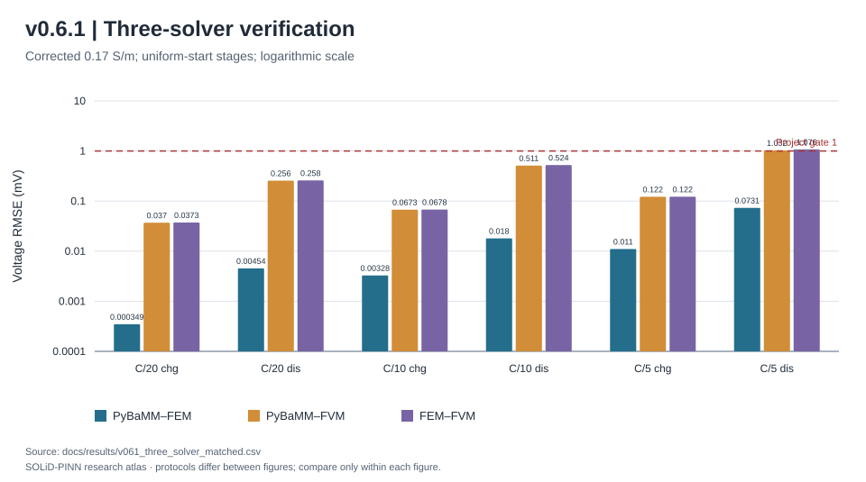
Corrected cathode conductivity 0.17 S/m. Six matched uniform-start stages; 16/18 pairwise voltage comparisons pass the 1 mV project threshold. FVM C5 discharge remains above it. See [historical verification](../v06_independent_verification.md) and [corrected audit](../v061_physics_audit.md). The synthetic OCV verification is not an experimental prediction.

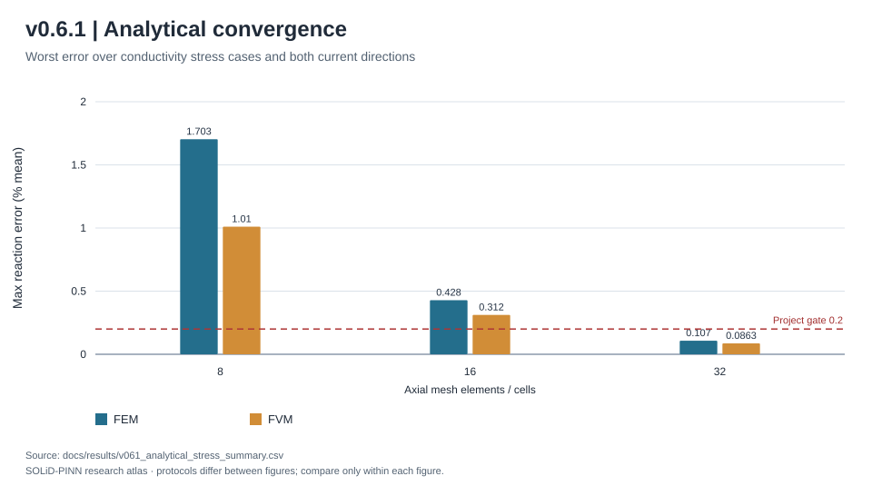
Fuller–Harb linear-kinetics small-signal benchmark: worst normalized reaction error across the conductivity cases decreases under mesh refinement; 32-element/cell stress cases pass the 0.2% project target. The graph uses rounded archived local aggregate maxima; analytical source and test driver are in the [audit](../v061_physics_audit.md).

## COMSOL C20 — initial discrepancy and parameter transfer
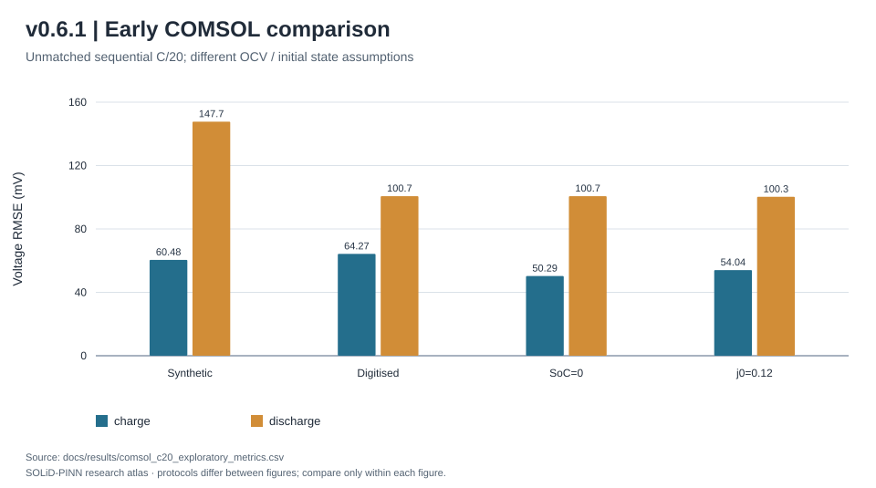
OCV/initial SOC changes alone did not resolve the C20 discharge discrepancy. [Initial audit](../comsol_c20_reference_audit.md) includes failed nonlinear solves.

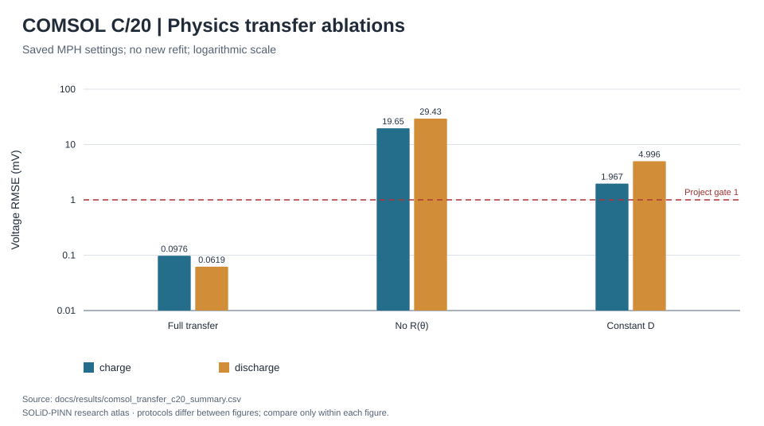
Using saved MPH geometry, occupancy windows, D(theta), R(theta) and kinetics reduced the discrepancy to sub-mV. Removing R or using constant D degraded agreement. [Transfer report](../comsol_c20_transfer.md) includes the interrupted constant-j0 ablation and initial transient caveat.

## Multirate — frozen numerical transfer versus reference data
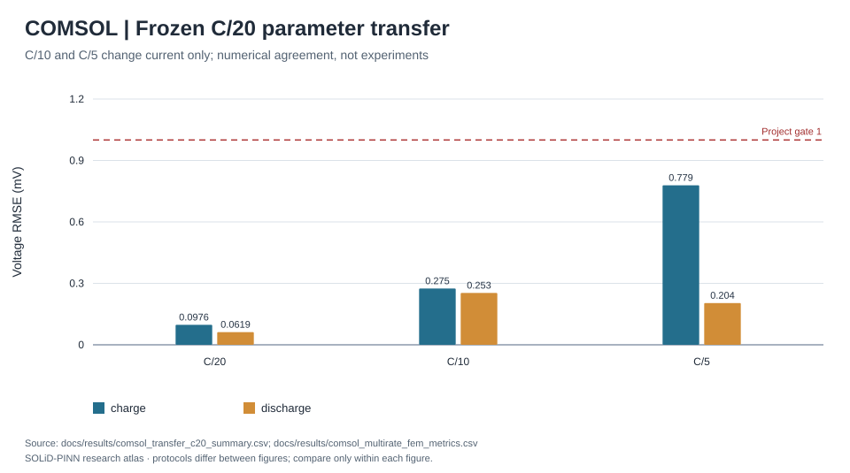
Frozen C20 settings predict the supplied COMSOL simulations at C10 and C5 within 1 mV over the reported common intervals. This is numerical transfer; full field/mesh verification remains open.

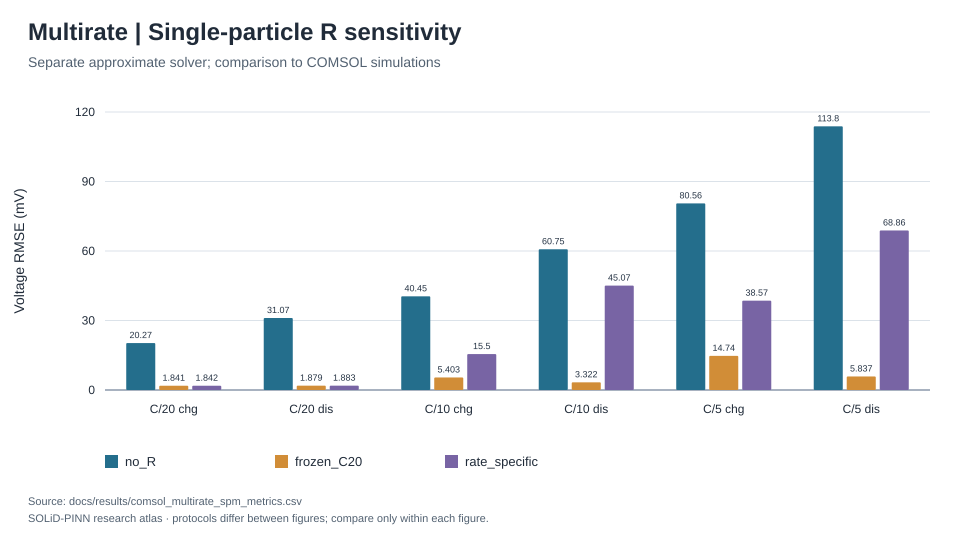
The separate single-particle diagnostic favours frozen C20 R over rate-specific CSV R for reproducing the supplied COMSOL outputs. It does not prove the actual Study configuration; additional FEM rate-specific cases were interrupted.

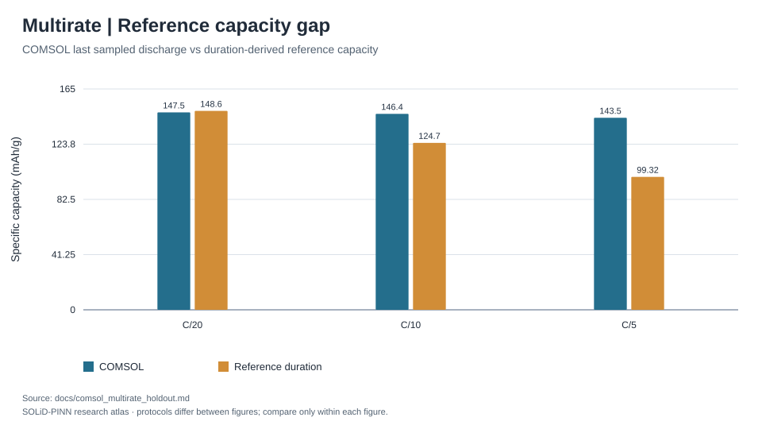
The supplied COMSOL simulations overpredict reference-derived capacity at higher rates. The reference duration-based capacity is calculated as 165 * duration_h / rate denominator, not the exact reported cycle capacity; observed COMSOL discharge ends before the exact cutoff. Reference provenance/cycle association unresolved. See [multirate report](../comsol_multirate_holdout.md).

## v0.7 — first falsification of additional terminal resistance
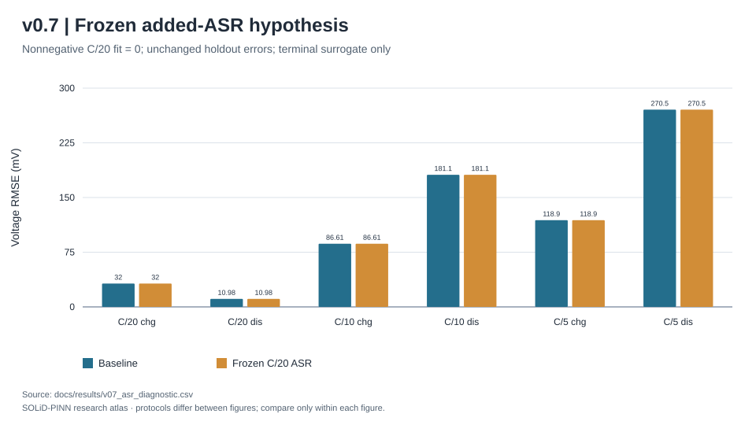
C20-only nonnegative added ASR selects zero and leaves C10/C5 reference errors unchanged.

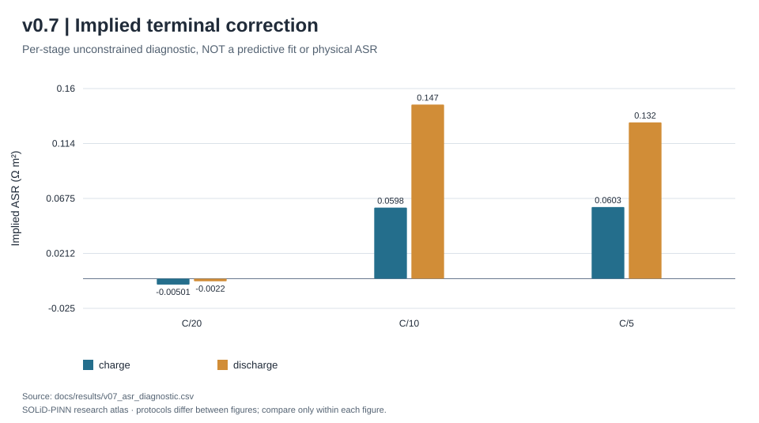
The rate/stage-dependent implied corrections are diagnostic, not predictions or measured interface parameters. The model needs additional independent evidence to identify a rate-dependent mechanism. See [v0.7 report](../v07_rate_diagnostic.md).

## v0.7.1 — rate capability and same-rate capacity fade

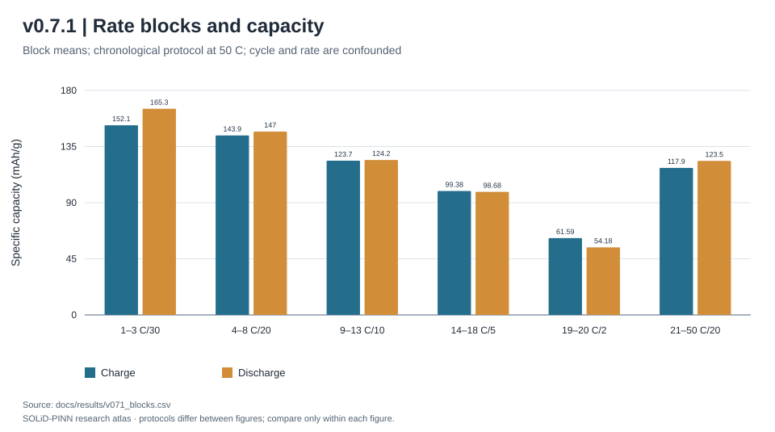
The two collaborator cycle CSVs match all 22 retention anchors from Dessantis Table 1. Rate and cycle number remain confounded.

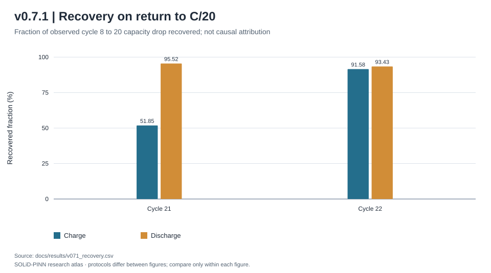
By cycle 22, 91.58% of the charge and 93.43% of the discharge drop from cycles 8 to 20 has recovered. Cycle 21 charge recovery is incomplete.

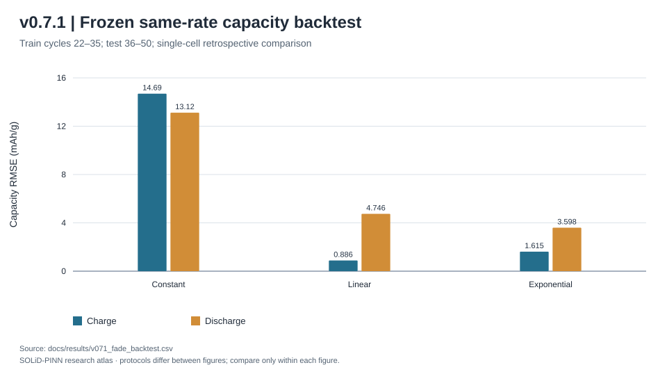
Training cycles 22–35 and testing cycles 36–50 at C/20 gives best retrospective RMSE of 0.886 mAh/g for linear charge and 3.598 mAh/g for exponential discharge. The transition-cycle inclusion sensitivity and all failed alternatives are retained; no independent validation or universal degradation law is claimed.

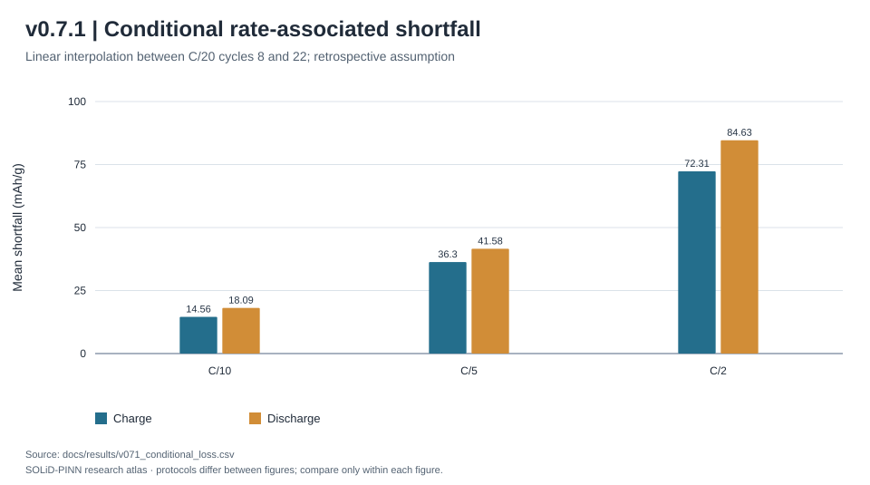
The interpolated C/20 counterfactual uses cycles 8 and 22; the resulting retrospective shortfalls are conditional, not identified causal effects or forecast parameters. See [v0.7.1 report](../v071_rate_fade_decoupling.md), including provenance, assumptions, and bounds.

## v0.7.2 — independent paper-constrained reproduction

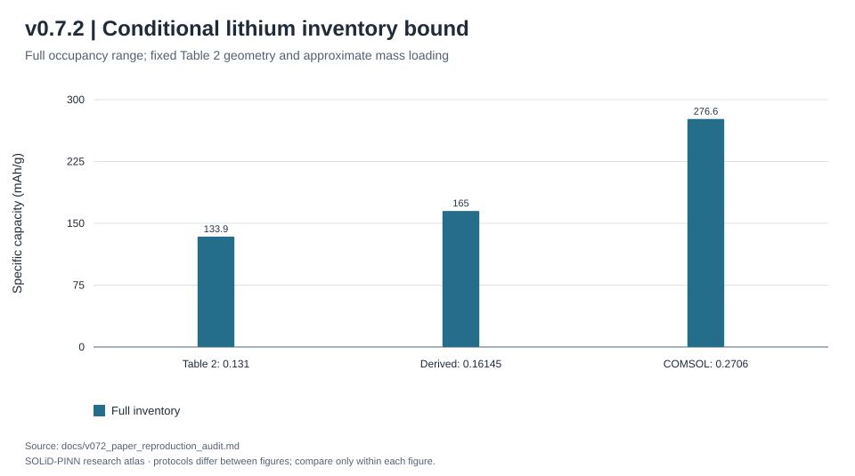
Treating Table 2's 0.131 as active fraction gives a full lattice capacity of 133.88 mAh/g, below the supplied C20 reference. This depends on the approximate mass loading and ambiguous phase interpretation; it is not proof of a paper error.

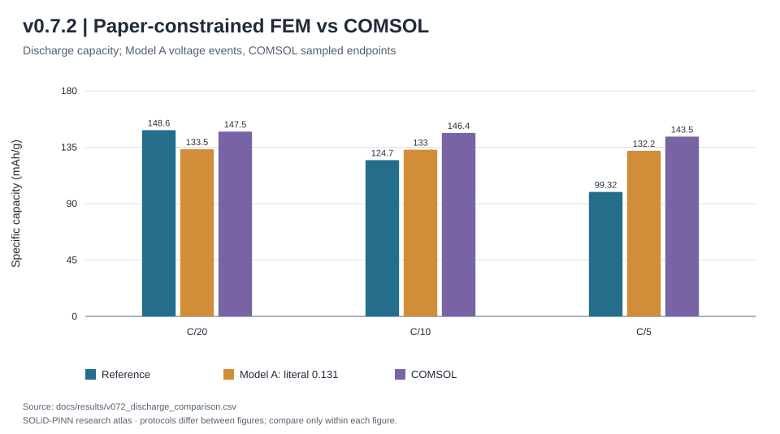
The constant-D paper-constrained FEM and collaborator COMSOL simulation both miss higher-rate capacity losses. Eleven actual stage results are archived; remaining trials were interrupted. No new fit or exact reproduction claim. See [audit](../v072_paper_reproduction_audit.md).

## Reproduction and interpretation
- [Versioned chart data](chart_data.json) links each figure to its metric CSV or report.
- Run `node scripts/render_research_atlas.mjs` from repository root to regenerate SVGs.
- Figures use linear or explicitly marked logarithmic scales; dashed lines are project gates, not literature standards.
- Do not pool RMSE across figures with different sampling, OCV, initial states, or reference targets. All reports retain adverse outcomes.
- Citations: [CITATIONS.bib](../../CITATIONS.bib). Open question: [Issue #2](https://github.com/theerayutbo/SOLiD-PINN/issues/2).
